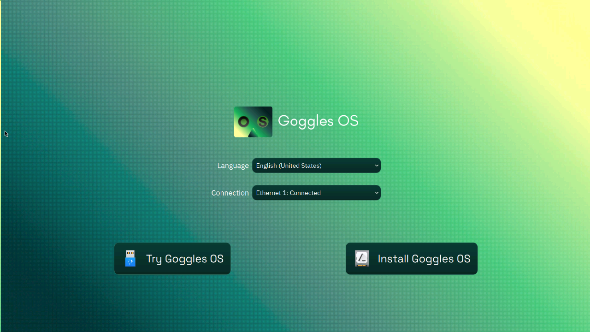
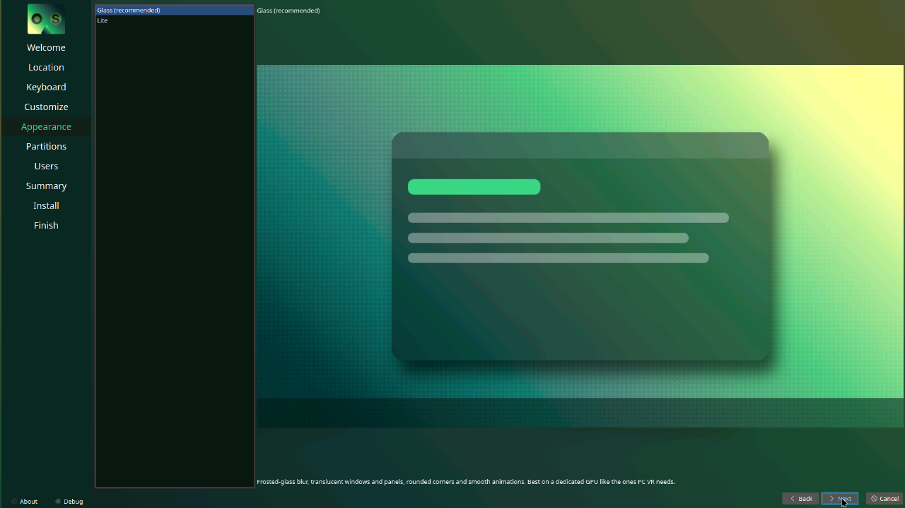
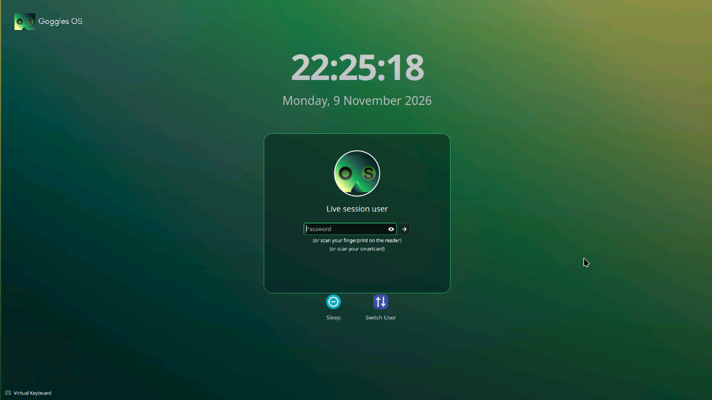

<p align="center">
  <picture>
    <source media="(prefers-color-scheme: dark)" srcset="docs/images/logo-dark.png">
    
  </picture>
</p>

<p align="center">
  <b>The Linux desktop built for PC VR gaming.</b><br>
  VR-ready with GogglesXR, tuned for NVIDIA and AMD, with a frosted-glass KDE Plasma desktop.
</p>

<p align="center">
  <a href="https://jamoijyt.github.io/gogglesos/"><b>Website</b></a> ·
  <a href="https://jamoijyt.github.io/gogglesos/#download">Download</a> ·
  <a href="https://jamoijyt.github.io/gogglesos/#build">Build guide</a> ·
  <a href="ROADMAP.md">Roadmap</a>
</p>

<p align="center">
  <a href="LICENSE"></a>
  
  
  
</p>

<p align="center">
  
  
  
  <br>
  <sub>Live welcome screen · Glass/Lite choice in the installer · Lock screen</sub>
</p>

---

Goggles OS is based on **Kubuntu 26.04 LTS** (Ubuntu + KDE Plasma). The build remasters the
official Kubuntu ISO: it unpacks the live filesystem, customizes it in a chroot, and writes a new
ISO that keeps Kubuntu's Secure Boot chain, live session and Calamares installer.

> [!WARNING]
> **Early development.** Test in a VM before installing on real hardware.
> See [ROADMAP.md](ROADMAP.md) for what's planned (GogglesXR, its own VR runtime with Quest streaming and a dashboard; Goggles Home; Rift CV1).

## What's inside

| Area | What Goggles OS adds |
|---|---|
| VR | **GogglesXR**: streams VR to standalone headsets such as the Meta Quest and runs SteamVR games with no per-game setup. Desktop app (status, game library with cover art, settings) that starts at login, and a five-panel dashboard inside the headset, drawn on top of your game. Steam and `steam-devices` udev rules (Index, Vive, Quest, controllers) |
| GPU | Mesa + Vulkan for AMD/Intel (64- and 32-bit). The `nvidia` variant also includes NVIDIA 580 with prebuilt, signed modules (GTX 900 to RTX 40, including GTX 1080) |
| Kernel | Stock Ubuntu kernel with `preempt=full threadirqs` (full preemption), plus SteamOS-style sysctls (`max_map_count`, no split-lock penalty, low swappiness) |
| Gaming | GameMode, MangoHud, GOverlay, Protontricks, ProtonUp-Qt (Flatpak, for Proton-GE), Flathub enabled |
| Apps | OBS Studio, Discord |
| Look | **Glass** (default) or **Lite** mode, chosen in the installer and switchable with *Goggles Appearance*; **Visor** taskbar (a centred, rounded glass bar with a glowing green top edge; *Goggles Taskbar* switches it to full width); frosted-glass popups with a light rim and visor line; **Goggles HUD** desktop widget (CPU, RAM, GPU, network); Windows 10-style start menu (Tiled Menu); Goggles Dark colours; rounded corners; Papirus-Dark icons with green folders; green lock screen |
| Branding | os-release, wallpaper, boot splash, startup splash (lenses that light up), live welcome screen, Goggles login screen, installer and slideshow, About-this-System |
| VMs | VMware guest tools (screen resize, clipboard) |
| Updates | **Goggles Update**: installed systems get new Goggles OS changes from GitHub without a new ISO |

## Building (Windows + WSL2, or any Ubuntu 26.04 machine)

Needs about 15 GB free inside WSL for the unpacked system and about 15 GB on the drive in
`CACHE_DIR` / `OUTPUT_DIR` (default `D:\GogglesOS`). Edit `config.sh` to change any of these.

```bash
sudo apt install xorriso squashfs-tools imagemagick webp
```

```bash
sudo ./build.sh
```

```bash
sudo GPU_VARIANT=amd ./build.sh
```

The finished ISO is written to `D:\GogglesOS\output\gogglesos-26.04-<variant>-amd64.iso`.
Flash it to a USB stick with Rufus (DD mode) or balenaEtcher.

Faster rebuilds:

- `sudo RESUME=1 ./build.sh` re-runs the customization on the already unpacked system
  (use after a build fails partway through customizing).
- `sudo REUSE_ROOTFS=1 ./build.sh` only repacks the existing system into a new ISO.

On a 16 GB PC, close other apps before the compression step, and run `wsl --shutdown`
after a build to give WSL's memory back to Windows.

## Updating an installed system

Goggles Update applies Goggles OS changes (desktop look, branding, tools, new apps added to
`config.sh`) to an installed system, so you don't need a new ISO for each change. It downloads the
source for the chosen version from GitHub and runs the same configuration step the ISO build uses
(`chroot/apply-system.sh`). Ubuntu packages and drivers keep updating through Discover as usual.

- **App menu:** open **Goggles Update**. A daily check also shows a popup when there's something new.
- **Terminal:**

  ```bash
  sudo goggles-update
  ```

- **Channels:** `stable` (the default) installs GitHub releases only. `main` installs every change
  merged into the `main` branch, which is what you want while there are no releases yet:

  ```bash
  sudo goggles-update --channel main
  ```

- **Undo the last update:**

  ```bash
  sudo goggles-update --rollback
  ```

The Glass or Lite mode chosen in the installer, and each user's own choice in Goggles Appearance,
are kept. Desktop changes show after logging out and back in. Each run is logged to
`/var/log/gogglesos-update.log`.

**Systems installed before Goggles Update existed** need it fetched once; after that it updates itself:

```bash
wget -O /tmp/goggles-update https://raw.githubusercontent.com/jamoijyt/gogglesos/main/overlay/usr/bin/goggles-update
```

```bash
sudo python3 /tmp/goggles-update --channel main --apply
```

## Testing in a VM

```powershell
.\vmware-test-vm.ps1
```

Creates a VMware Workstation VM in `D:\GogglesOS\vmware` (UEFI + Secure Boot, 3D acceleration,
4 CPUs, 6 GB RAM, 64 GB disk), attaches the ISO and starts it. Re-run after a rebuild to load the
new ISO, or add `-Recreate` to start from a blank disk.

`hyperv-test-vm.ps1` does the same with Hyper-V (slower: no GPU acceleration); `hyperv-keys.ps1`,
`hyperv-click.ps1` and `hyperv-screenshot.ps1` drive that VM from scripts.

## Layout

```
config.sh                     name, versions, package lists, GPU variant
build.sh                      unpack ISO -> chroot customize -> repack ISO
chroot/customize.sh           runs inside the live filesystem (packages, drivers, installer)
chroot/apply-system.sh        system configuration shared by the build and Goggles Update
gogglesxr/dashboard/          GogglesXR dashboard (Godot 4 project): five panels, lasers, grip + swipe
gogglesxr/overlay-extension/  small C extension that lets the dashboard draw on top of a running game
chroot/visor-panel.py         draws the Visor taskbar and popup backgrounds for the Plasma theme
chroot/splash/                startup splash (QML)
chroot/sddm-theme/            login screen (SDDM theme, QML)
chroot/hud-plasmoid/          Goggles HUD desktop widget (Plasma widget, QML)
chroot/calamares/             installer pages (Appearance: Glass / Lite)
chroot/calamares-show.qml     installer slideshow
chroot/tiledmenu-tiles.json   default start-menu tiles
branding/source/              original artwork
branding/make-assets.sh       generates every image size from branding/source
branding/build-installer-prompt.sh   rebuilds the live "Try or Install" screen with Goggles branding
overlay/                      files installed into the system (/etc, /usr)
  usr/bin/goggles-theme       Glass / Lite switcher
  usr/bin/goggles-panel       taskbar layout switcher (Visor / wide)
  usr/bin/goggles-hud         show or remove the Goggles HUD widget
  usr/bin/gogglesxr           GogglesXR command: setup, self-check, dashboard, desktop app
  usr/share/gogglesos/gogglesxr/   GogglesXR desktop app (app.py) and game library (library.py)
  usr/bin/goggles-update      Goggles Update (plus its daily check in usr/lib/systemd/user/)
  usr/libexec/gogglesos/      lock-screen patch + re-apply hook run after package updates
third_party/                  pinned, checksum-verified copies of upstream tools (see its README)
test-iso.sh                   QEMU boot test with screenshots (headless, window or browser view)
vmware-test-vm.ps1            VMware test VM
hyperv-*.ps1                  Hyper-V test VM and helpers
docs/index.html               the website (GitHub Pages)
docs/images/                  website and README logos and screenshots
```

## Design notes

- **Stock kernel instead of XanMod/Liquorix.** Ubuntu's kernel is `PREEMPT_DYNAMIC`, so
  `preempt=full` gives the same low-latency scheduling as a "lowlatency" kernel. It also keeps
  Secure Boot and Ubuntu's prebuilt NVIDIA modules working; with a third-party kernel, NVIDIA
  would have to rebuild through DKMS on every update.
- **`ID=ubuntu` is kept in os-release.** Ubuntu tools (`ubuntu-drivers`, PPAs,
  Steam's runtime checks) rely on it. Only `NAME`/`PRETTY_NAME`/`VARIANT` say Goggles OS.
- **GRUB's distributor is left as Ubuntu.** Ubuntu's signed GRUB looks in `EFI/ubuntu`.
  Renaming it would break Secure Boot on later GRUB updates.
- **RTX 50-series** needs NVIDIA's open kernel modules. Build with
  `NVIDIA_BRANCH=580-open`, but note that build will **not** support GTX 10-series cards.
- **Goggles Update only installs what GitHub says is the requested commit.** It checks the
  commit stamp GitHub puts in every source archive, and it only runs as root after you approve
  it (menu: an administrator prompt; terminal: `sudo`). The daily check runs as your user and
  only shows a popup.
- **No code is downloaded and run at build time** except Ubuntu packages, the rounded-corners
  PPA, Flathub and Discord's official `.deb`. Other upstream tools are pinned in `third_party/`.
- **Files are installed with root ownership and fixed permissions**, and the build fails if
  anything in the image is owned by the build user or world-writable.

## Licence

The build scripts and configuration are licensed under the **GNU GPL v3.0**; see [LICENSE](LICENSE).

The Goggles OS name, logos and wallpaper (`branding/source/` and the logos in `docs/images/`) are
**not** covered by the GPL: all rights reserved. Forks should use their own branding.

Upstream components keep their own licences: Kubuntu/KDE (GPL/LGPL), KDE Rounded Corners (GPL-3.0),
Tiled Menu (GPL-2.0+), papirus-folders (MIT), Papirus icons (GPL-3.0), NVIDIA driver (proprietary,
from Ubuntu's restricted archive), Steam and Discord (proprietary, downloaded from their vendors).
